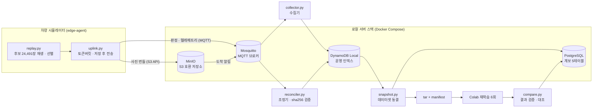
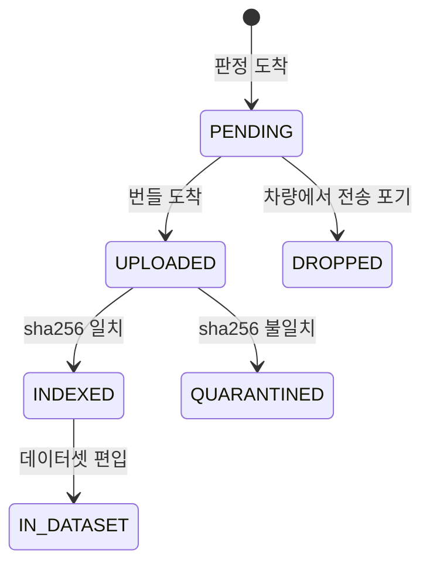

# NeedSlack Cloud

> **엣지 장치가 고른 데이터를 수집 → 검증 → 데이터셋 → 재학습까지 잇는 데이터 경로를 로컬 서버 스택(Docker)으로 직접 구축하고,
> 경진대회 팀 연구에서 오프라인으로 나온 결과가 이 경로를 지나도 그대로 재현되는지 검증한 프로젝트입니다.**

- **기간·형태**: 2026.09 · 개인 프로젝트 (경진대회 팀 연구를 혼자 확장)
- **환경**: Windows 11 · Docker(WSL2) 위의 로컬 스택 4종 — Mosquitto · MinIO · DynamoDB Local · PostgreSQL
- **언어·도구**: Python 3.12 (표준 라이브러리 + boto3 · psycopg · paho-mqtt), SQL, Docker Compose
- **결과 요약**
  - 두 실험군 각 **2,449건**의 선별 데이터가 **유실·중복 없이** 저장되었음을 보낸 쪽과 받은 쪽 건수로 대조 (QUARANTINED 0)
  - 오프라인 결과 Δ mAP50 **+0.0241** → 파이프라인 통과 후 **+0.0240** (95% CI [+0.0105, +0.0383]) — **재현**
  - 운영 중 발견한 **조용한 유실**(메시지 1,000건에서 경고 없이 끊김)의 원인을 찾아 해결
  - 같은 코드를 환경변수 전환만으로 **AWS(서울)** 에 붙여, 장치별 접근 격리가 성립함을 확인한 뒤 자원 전부 철거

---

## 배경 — 왜 만들었나

경진대회에서 팀은 **NeedSlack — 차량 AI SoC의 미사용 실행시간 회수를 위한 HW 자원 관리 구조**를 연구했습니다.
차량 AI 칩이 쉬는 시간을 회수해, 학습 가치가 높은 장면을 골라 올리는 데 쓰는 구조입니다.
"동적 선별(DYN_B)"이 "정적 선별(STA_B)"보다 재학습 성능을 **Δ mAP50 +0.0241** 올린다는 결과였지만, 이 수치는
**오프라인 시뮬레이션 안에서만** 나온 것이었습니다.

실제로 데이터가 차량을 떠나 서버에 쌓이는 경로에서는 **유실 · 중복 · 순서 뒤바뀜 · 손상**이 생깁니다.
그 경로를 직접 만들어 통과시켜도 결과가 살아남는지 확인하고 싶었고, 대회 이후 이 부분을 혼자 확장했습니다.

| 구분 | 팀 연구 NeedSlack (이 저장소에 없음) | 이 저장소 — 개인 확장 |
|---|---|---|
| 범위 | 엣지 가속기 하드웨어 · 선별 알고리즘 · 오프라인 재학습 실험 | 수집 서버 · 상태 관리 · DB 스키마 · 데이터셋 동결 · 재학습 결과 대조 · AWS 이전 검증 |
| 이 저장소와의 관계 | 결과물(선별 배열 · 프레임 파일)을 **읽기만** 한다 | 팀 연구 코드를 import 하지 않고, 필요한 수치는 생성기로 뽑은 **스냅샷**(`schema/edge_contract.json`)으로만 쓴다 |

---

## 아키텍처



**설계의 출발점 — 성격이 다른 두 데이터를 같은 길로 보내지 않는다.**
판정(어느 장면을 골랐는가)은 50 ms 안에 나오고, 사진 묶음(번들)은 통신 사정에 따라 최대 13.6시간 늦게 도착할 수 있습니다.
지연 허용치가 약 10⁶배 다르기 때문에 판정은 MQTT로, 번들은 S3 API로 나눠 보내고, 서버에서 둘을 다시 맞춥니다.

### 데이터 한 건의 상태 — 조건부 전이



- 모든 전이는 **"현재 상태가 X일 때만"** 일어나는 조건부 쓰기입니다(`ConditionExpression="#state = :src"`).
  수집기와 조정기가 같은 데이터를 동시에 옮기려 해도 한 번만 바뀝니다.
- 판정과 번들 중 **어느 쪽이 먼저 와도** 같은 결과에 닿습니다. 실제 운영에서 한 실험군의 2,449건 전부가
  "번들 먼저" 경로로 INDEXED에 도달했고, 다른 실험군에서는 중복 도착 4건이 결과를 바꾸지 않고 흡수됐습니다.
- 잘못된 상태는 코드보다 **DB 제약이 먼저 막습니다** — 예: 검증되지 않은 캠페인은 배포 불가
  (`CHECK (parity_verified)`), 같은 학습 조건의 중복 실행 금지(`UNIQUE (ds_id, seed, epochs, batch, imgsz, arch)`).
  스키마는 되돌리는 마이그레이션(`001_init.down.sql`)과 함께 있습니다.

---

## 결과

### 1. 수집 — 보낸 건수와 저장된 건수 대조

| 항목 | STA_B | DYN_B |
|---|---|---|
| 후보 → 선별 → 저장 | 24,491 → 2,449 → **2,449 INDEXED** | 24,491 → 2,449 → **2,449 INDEXED** |
| 체크섬 불일치(QUARANTINED) | 0 | 0 |
| 번들 · 용량 | 70개 · 524.9 MB | 70개 · 502.1 MB |
| 도착 지연 최대 | 3,106 s | 2,801 s |

### 2. 데이터셋 동결과 계보

- 번들에서 잘라낸 이미지 2,449장 전부가 원본과 **sha256 일치**. 다시 만들어도 tar의 sha256이 같습니다(동결 확인).
- 학습 결과에서 원본 프레임까지 **조인 한 번으로 2,449행** 역추적됩니다.

### 3. 재학습 — 결과가 경로를 지나도 살아남는가

| mAP50 (held-out 2,826장) | 파이프라인 (3시드 평균) | 오프라인 (팀 연구) |
|---|---|---|
| STA_B | 0.3040 ± 0.0030 | 0.2989 ± 0.0049 |
| DYN_B | 0.3280 ± 0.0101 | 0.3230 ± 0.0049 |
| **Δ (DYN − STA)** | **+0.0240** [+0.0105, +0.0383] | +0.0241 [+0.0115, +0.0369] |

부호가 같고, 신뢰구간이 0을 포함하지 않으며, 파이프라인 Δ가 오프라인 신뢰구간 안에 있습니다.
시드별 값은 오프라인과 최대 0.02 다르지만 원인(학습 환경 차이 등)은 **확인하지 못했습니다** — 확인된 것과 추정을 나눠 적었습니다.

### 4. (보조) AWS로 옮겨 보기 — 서울 리전

어댑터(`common/aws.py`)의 대상만 바꿔(`DDB_TARGET=aws` · `MQTT_TARGET=aws`) **코드 수정 없이** IoT Core · DynamoDB에 붙였습니다.
최소 권한 IAM 사용자로만 실행되며, 루트 키로 실행하면 스크립트가 멈춥니다.

| 확인 | 결과 |
|---|---|
| 차량 A가 자기 토픽에 발행 | 수신 ✓ |
| 차량 A가 차량 B의 토픽에 발행 · B의 ID로 접속 | **거부** ✓ |
| 차량 A의 임시 자격으로 B의 저장 경로에 쓰기 · 버킷 목록 조회 | **AccessDenied** ✓ |
| 3,000 후보 재생 → IoT Core → AWS DynamoDB → INDEXED | 147 / 147 ✓ |
| `m4 down` 뒤 남은 자원 | 없음 ✓ |

---

## 운영하며 발견한 문제

| 증상 | 원인 | 해결 |
|---|---|---|
| 수집기를 잠시 끈 사이 보낸 메시지가 **오류 로그 없이 1,000건에서 끊김** | Mosquitto `max_queued_messages` 기본값 1,000 — 초과분을 경고 없이 버림 | `infra/mosquitto.conf`에 100,000으로 설정. 이후 모든 런을 양 끝 건수 대조로 확인 |
| 구독자가 정확히 **120초마다 재연결** | 메시지 콜백 안에서 번들(약 8초)을 처리해 keepalive 응답이 밀림 | 콜백은 큐에 넣기만 하고 처리는 작업 스레드로 (`ingest/subscriber.py`) |
| 점검용 재생 메시지가 **운영 테이블에 섞여 들어옴** | 수집기가 꺼져 있어도 영속 세션에 메시지가 쌓였다가 다음 기동 때 처리됨 | 운영 버킷이 아닌 판정·이벤트는 수집기·조정기가 거부 |
| `docker info`가 오류를 내고도 **종료코드 0** | 엔진 기동 중 API가 500을 반환 | 종료코드만 믿지 않고 응답 형태까지 확인 (`infra/bootstrap/00_check.ps1`) |
| `minio/minio` 이미지 pull 실패 | Docker Hub 저장소가 사라짐 | `quay.io` 공식 미러로 교체. 모든 이미지를 **태그@다이제스트로 고정** |
| 한글이 든 `.ps1`이 파싱 오류 | PowerShell 5.1이 BOM 없는 파일을 cp949로 읽음 | UTF-8 BOM으로 저장하고 테스트(`tests/test_scripts.py`)로 검사 |

---

## 실행 방법

```bash
python -m venv .venv && .venv/Scripts/pip install -r requirements.txt   # Windows 기준
cp .env.example .env

python run.py check       # 환경 점검 (WSL · Docker Desktop · 엔진)
python run.py up          # 로컬 스택 4종 기동
python run.py bootstrap   # 버킷 · 버킷 알림 · 테이블 · PG 스키마 생성 (여러 번 돌려도 같은 결과)
python run.py test        # 단위 테스트
python run.py down        # 스택 정지 (데이터는 볼륨에 유지)
```

- 테스트는 표준 `unittest`만 쓰며 **스택 없이** 돕니다. 스택이 떠 있으면 같은 시나리오를 DynamoDB Local과
  PostgreSQL에도 돌려 메모리 구현과 결과를 대조합니다(개발 당시 113건 통과).
- `replay` · `snapshot` · `notebook` · `contract`는 팀 연구 산출물이 필요해 이 저장소만으로는 실행되지 않습니다.
  Colab 노트북도 팀 연구 코드를 원문 그대로 싣기 때문에 저장소에 두지 않았습니다.

---

## 디렉터리

```
edge-agent/   차량 시뮬레이터 — 재생 · 토큰버킷 · 저장 후 전송 (계약값은 런타임에 JSON에서 읽음)
ingest/       수집기 · 조정기 · 키 규약과 상태 전이의 단일 구현(store.py)
pipelines/    데이터셋 스냅샷 · Colab 노트북 생성기 · 재학습 결과 대조
schema/       판정 레코드 계약 · DynamoDB 테이블 정의 · PostgreSQL 스키마(+down)
infra/        docker-compose · Mosquitto 설정 · 부트스트랩 · AWS 구축/철거 스크립트와 IAM 정책
common/       AWS·로컬 어댑터 (boto3 · paho는 여기서만)
tests/        단위 · 통합 테스트
docs/         설계 분석 · PRD · 설계 결정 기록 · 작업 규칙 · 개발 기록
```

## 문서

| 문서 | 내용 |
|---|---|
| [`docs/분석보고서_Edge투Cloud아키텍처.md`](docs/분석보고서_Edge투Cloud아키텍처.md) | 수집 · 백엔드/DB · MLOps · 비용 설계 분석 |
| [`docs/PRD_쐐기.md`](docs/PRD_쐐기.md) | 2주 안에 만들 범위와 성공 기준 |
| [`docs/구현설계_MVP.md`](docs/구현설계_MVP.md) | 작업 순서 · 와이어 계약 · 스키마 · 로컬 스택 |
| [`docs/설계결정-0001-엣지-회수기전-중립성.md`](docs/설계결정-0001-엣지-회수기전-중립성.md) · [`0002`](docs/설계결정-0002-M3-학습데이터-이관.md) | 내린 결정과 근거, 되짚을 조건 |
| [`docs/작업규칙.md`](docs/작업규칙.md) | 진행하며 지킨 규칙 — 수치 하드코딩 금지 · 되돌릴 수 없는 작업은 확인 후 실행 · 측정과 추정 구분 |
| [`docs/개발기록.md`](docs/개발기록.md) | 마일스톤별 실측 기록 원본 (2026-09-22 기준) |

## 한계

- 실제 차량이 아닌 **시뮬레이터**로 재생했고, 실험 규모는 실험군당 1회(2,449건)입니다.
- AWS 이전은 판정 경로 하나만 올려 격리를 확인한 단계이며, 서버를 클라우드에 상시 배포하지는 않았습니다.

## 함께한 사람

| 이름 | 역할 |
|---|---|
| 장민영 ([@minch-070605](https://github.com/minch-070605)) | 범위·설계 결정, 구현, 로컬 스택·AWS 운영, 실험 실행과 결과 검증 |
| Claude Code (Anthropic) | AI 페어 프로그래머 — 코드·문서 작성 보조와 리뷰 |

출발점이 된 경진대회 연구 NeedSlack은 팀 공동 연구이며, 이 저장소에는 포함하지 않았습니다.
