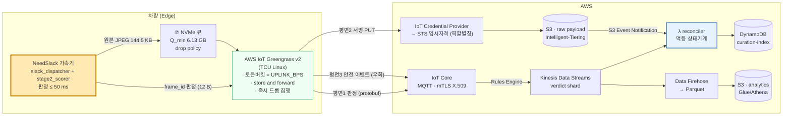
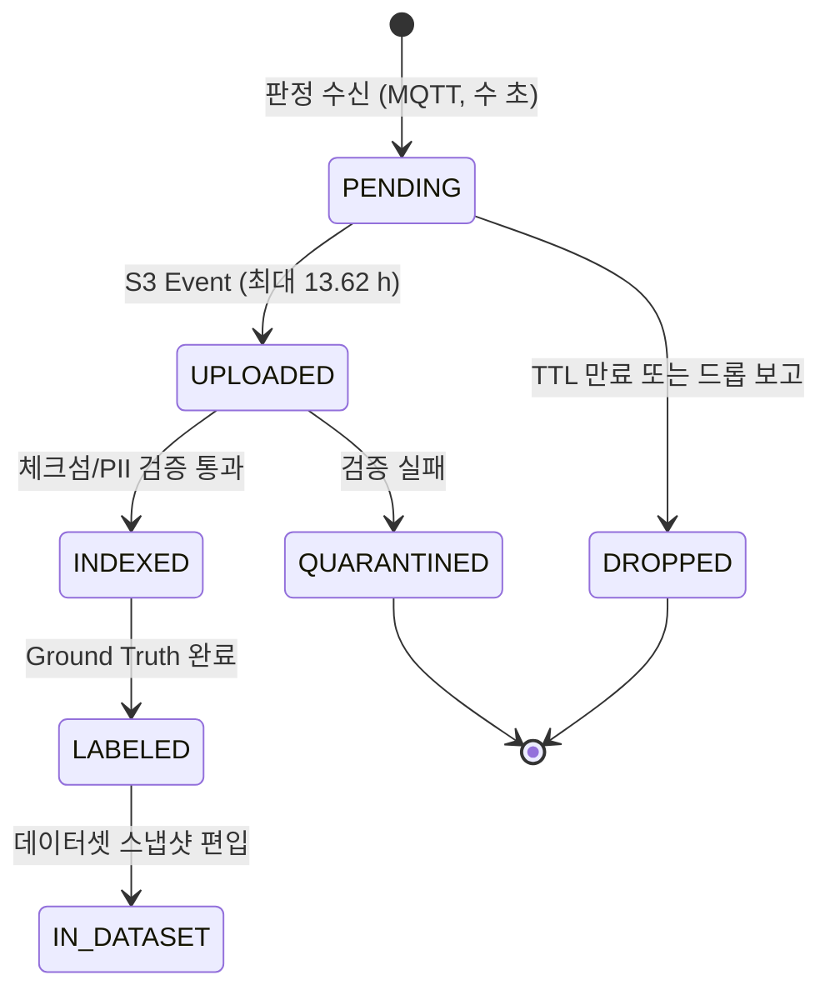
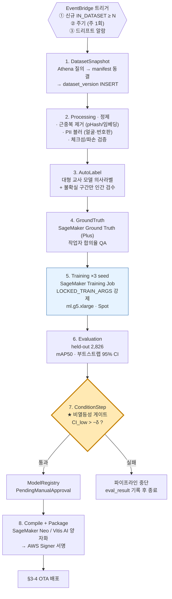
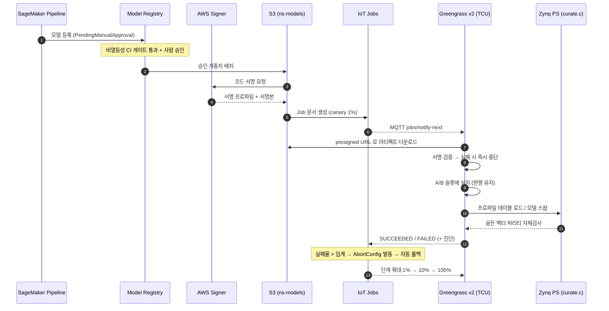
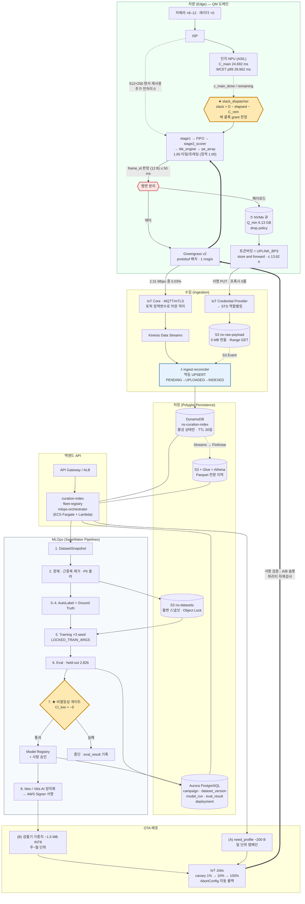
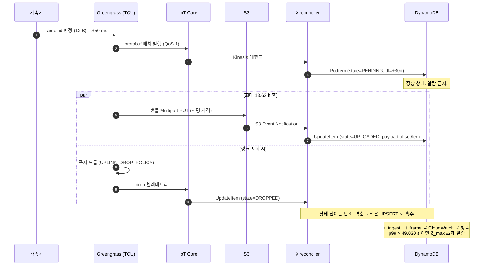
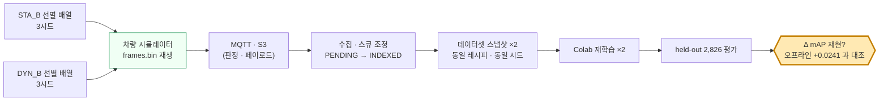

# NeedSlack — Edge-to-Cloud 통합 아키텍처 분석 보고서

> 작성 2026-09-20 · 대상 `rev.9/` (내용 rev.10) · 관점 **클라우드 솔루션 아키텍트 / 백엔드 서버 엔지니어**
>
> **이 보고서는 새 가정을 만들지 않는다.** 대역·지연·큐·페이로드의 모든 물리량은
> `01_문서/갈래A_전환.md §6`(업링크 예산 폐쇄)과 `02_전처리/config.py`에 **이미 유도되어 있고**,
> 레코드 레이아웃은 `02_전처리/s7_export_board.py`, 판정 경계는 `07_RTL/rtl/stage2_scorer.v:168`,
> 산업 포지셔닝은 `01_문서/분석보고서_학술산업가치.md §3-2~3-4`에 있다.
> 이 문서가 하는 일은 **그 계약을 AWS 서비스 경계로 번역**하는 것뿐이다.
>
> ---
>
> **포지셔닝** — 이 프로젝트에는 실험이 **하나뿐**이다. 주 실험은 rev.9 하드웨어의
> **동적 vs 정적 대조**(Δ mAP +0.0241)이고, 클라우드는 자체 대조축을 세우지 않는다.
> 클라우드는 **두 번째 실험이 아니라, 첫 번째 실험의 산업적 전제가 실재함을 보이는
> 계측 장치**다. 상세는 §5.

---

## 0. 출발점 — 엣지가 클라우드에 넘기는 "계약"은 이미 닫혀 있다

클라우드 설계를 시작하기 전에, 차량 쪽에서 **이미 확정된 인터페이스 계약**을 먼저 고정한다.
아래 값은 전부 `config.py`의 상수이거나 그로부터 유도되는 함수값이며, 이 보고서의
모든 설계 판단이 여기서 떨어진다.

| 계약 항목 | 값 | 강제 기전 | 출처 |
|---|---|---|---|
| 후보 스트림 주파수 `f_cand` | **20.0 Hz** | `T_FRAME_MS = 50.0` | `config.CAND_RATE_HZ` |
| 순시 선별률 `rate_inst` | **0.10** | 선별기 정책 | `config.SELECT_RATE[0]` |
| 프레임 페이로드 `S` | **144.5 KB** (실측 평균 149.0 KB) | nuScenes 1600×900 JPEG | `config.UPLINK_PAYLOAD_BYTES` |
| 판정 메타데이터 레코드 | **12 B** | `<II4B` 고정 레이아웃 | `s7_export_board.py:REC_FMT` |
| **판정 지연 상한** | **≤ 50 ms** | 구현별로 다름 — 아래 ⚠ 참조 | `stage2_scorer.v:168` / `slack_scheduler.v` |
| **도착 지연 상한 `L_max`** | **≤ 13.62 h** | 즉시 드롭 + 일주기 폐쇄 | `uplink_max_arrival_latency_s()` |
| 온보드 큐 요구 용량 `Q_min` | **6.13 GB** (⑦ NVMe) | `R_up/8 · (1−δ_max) · 24 h` | `uplink_queue_min_bytes()` |
| 주행 듀티 상한 `δ_max` | **0.4325** (10.38 h/일) | `rate_sustain / rate_inst` | `uplink_max_drive_duty()` |
| 큐 포화 시 정책 | **즉시 드롭** (`wait` 아님) | 지연을 유계로 만들기 위함 | `config.UPLINK_DROP_POLICY` |
| 링크 명목 대역 `R_up` | **1 Mbps** | **유일한 자유 파라미터** | `config.UPLINK_BPS` |

> ⚠ **판정 지연의 강제 기전은 엣지 구현에 따라 다르다. 상한은 같다.**
> 선점·재개 구현(`07_RTL`)은 `frame_start`가 `partial_bank`/`preempt_pend`를 리셋해
> 채점 상태가 프레임을 가로질러 살아남지 못하게 막는다. 비선점 승인제어 구현
> (`Teammate/slack_reclaim_zybo_v5`)은 `cost ≤ close_tick − elapsed`를 만족할 때만
> 작업을 시작해 창 밖으로 나가지 못하게 막는다. **클라우드 계약은 상한에만 의존하므로
> 두 구현 모두에서 성립한다** — 근거와 귀결은 `설계결정-0001`.

### 0-1. ★ 이 표에서 클라우드 아키텍처가 즉시 유도되는 지점

```
판정 지연 ≤ 50 ms                (하드 실시간, RTL 계약)
도착 지연 ≤ 13.62 h = 49,030 s   (베스트에포트, 큐 체류)
                    ────────────────────────
                    비율 ≈ 9.8 × 10^5  —  약 100만 배
```

**같은 전송 관(transport)에 태우면 안 된다.** 지연 SLO가 6자리수 다른 두 스트림을
하나의 MQTT 토픽이나 하나의 스트림에 섞으면, 느린 쪽(144.5 KB 이미지)이 빠른 쪽
(12 B 판정)의 큐를 막는 **head-of-line blocking**이 구조적으로 발생한다. 게다가
드롭 정책이 다르다 — 페이로드는 버려도 되지만(`drop`), 판정 레코드는 버리면
"그 프레임이 존재했다는 사실"이 소실되어 **함대 통계 자체가 편향된다.**

그래서 수집 파이프라인의 제1 설계 결정은 서비스 선택이 아니라 **평면 분리(plane separation)** 다.

| | 제어/판정 평면 | 벌크 페이로드 평면 | 안전 이벤트 평면 |
|---|---|---|---|
| 단위 크기 | 12 B (확장 후 ~48 B) | 144.5 KB | 가변 (스냅샷 번들) |
| 발생률/차량 | 2 msg/s (선별분) | 2 obj/s | 희소·비주기 |
| 지연 SLO | 초 단위 (준실시간) | ≤ 13.62 h | 초 단위 |
| 드롭 허용 | ❌ 불가 (통계 무결성) | ✅ `drop` 정책 | ❌ 불가 |
| 순서 보장 | 필요 (frame_id 단조) | 불필요 | 필요 |
| 비용 민감도 | 건당 과금에 민감 | GB당 과금에 민감 | 무시 가능 |

마지막 행이 서비스 선정을 거의 혼자 결정한다. 아래에서 그 논증을 편다.

---

## 1. Edge-to-Cloud 데이터 수집 파이프라인 (Ingestion)

### 1-1. 서비스 후보 대조 — 무엇을 왜 기각하는가

#### (a) 벌크 페이로드 평면 (144.5 KB/frame)

| 후보 | 하드 제약 | 비용 구조 | 판정 |
|---|---|---|---|
| **AWS IoT Core (MQTT)** | **메시지 최대 128 KB** | $1.00/100만 메시지 (5 KB 블록 과금 → 144.5 KB = 29블록) | ❌ **물리적으로 불가.** 크기 제한 미달이고, 블록 과금이라 GB당 단가가 S3의 수백 배 |
| **Kinesis Data Streams** | 레코드 최대 1 MB | 온디맨드 $0.08/GB 인입 + 리텐션 과금 | ❌ 크기는 되지만 **스트림은 저장소가 아니다.** 결국 S3로 다시 써야 하는데 인입 과금을 한 번 더 무는 셈. 10만대 208 TB/일 × $0.08 = **$16,646/일** |
| **API Gateway + Lambda** | REST 페이로드 10 MB | $1.00/100만 요청 + Lambda 실행 | ❌ **프록시 홉이 순수 낭비다.** Lambda가 바이트를 받아 S3에 다시 쓰는 구조 = 같은 바이트 2회 이동. 재개(resume) 불가라 셀룰러 단절에 취약 |
| **★ S3 직접 업로드 (Multipart)** | 객체 5 TB / 파트 5 GB | **PUT $0.005/1,000req · 인바운드 전송 $0** | ✅ **채택.** 프록시 0홉, 파트 단위 재개, 인입 대역 무료 |

> **결정적 논거 — AWS 인바운드 데이터 전송은 무료다.** 셀룰러 요금은 통신사에 내지만
> AWS로 들어오는 바이트 자체에는 요금이 없다. 따라서 벌크 평면의 최적해는
> "가장 얇은 경로로 S3에 직접 꽂는 것"이고, 그 사이에 관리형 서비스를 끼울수록
> GB당 단가가 순증한다. 10만대 함대에서 이 선택 하나가 **월 백만 달러 단위**를 가른다.

#### (b) 제어/판정 평면 (12 B/record)

| 후보 | 판정 |
|---|---|
| **★ AWS IoT Core (MQTT over mTLS)** | ✅ **채택.** X.509 디바이스 인증서 기반 상호 인증, QoS 1, 세션 지속(persistent session)으로 셀룰러 단절 후 재개, Rules Engine으로 코드 없이 Kinesis/Lambda 팬아웃. 차량 연결 관리 자체가 이 서비스의 존재 이유다 |
| Kinesis Data Streams 직접 | ❌ 차량이 IAM 자격을 직접 들고 `PutRecord`를 호출해야 한다. 수십만 대 자격 수명주기 관리를 직접 떠안게 됨 |
| API Gateway (HTTPS) | 🔶 가능하지만 **연결당 TLS 핸드셰이크 비용**이 크다. 20 Hz 후보 집계 텔레메트리까지 올리면 요청 수가 폭증 |

### 1-2. 채택 아키텍처 — 3평면 분리형 수집



#### 평면 1 — 판정 메타데이터 (IoT Core)

**토픽 스킴** — 차량 간 횡적 접근을 IoT 정책 변수로 차단한다.

```
ns/v1/${iot:Connection.Thing.ThingName}/curation/verdict    # 선별 판정 (QoS 1)
ns/v1/${iot:Connection.Thing.ThingName}/curation/telemetry  # 집계 (g, 드롭수, 큐점유)
ns/v1/${iot:Connection.Thing.ThingName}/safety/event        # 평면 3 (QoS 1, 우회)
$aws/things/${...}/jobs/#                                   # OTA (§3-4)
```

IoT Core 정책에 `${iot:Connection.Thing.ThingName}` 정책 변수를 쓰면, 인증서가 탈취돼도
**다른 차량의 토픽에 발행·구독할 수 없다.** 함대 규모에서 이것은 선택이 아니라 필수다.

**와이어 포맷 — JSON 금지, Protobuf 채택.**

```
온보드 원형 레코드        12 B   (frame_id u32 · ts u32 · conf_q8 · mean_p · kine · det)
+ 전역화/맥락 필드        ~36 B  (boot_id, value_score, tile_mask, gnss, campaign_id, ...)
────────────────────────────────
protobuf 인코딩          ~48 B   →  차량당 768 bit/s = 0.77 kbps
JSON 인코딩             ~260 B   →  차량당 4.16 kbps   (5.4배 인플레이션)
```

절대량은 둘 다 작지만(페이로드 평면의 0.03% vs 0.18%), **판정 평면은 건당 과금**이므로
메시지를 1초 단위로 배치(batch)한다. `rate 0.10 × 20 Hz = 2 판정/s`이므로 1초 배치 =
메시지 1건/s/차량. IoT Core 128 KB 한도 대비 압도적 여유이며, 10만대 함대에서
**메시지 수를 2억 건/일 → 1억 건/일**로 반감시킨다.

> **왜 20 Hz 후보 전량을 올리지 않는가.** 후보 18개(90%)의 판정 결과까지 올리면
> 20 msg/s/차량이 되고, 10만대에서 **1,728억 건/일**이 된다. 선별되지 않은 프레임의
> 정보는 **집계 텔레메트리**(히스토그램·분위수·카운터)로 압축해 5분 주기로 올린다.
> 이것으로 `g` 곡선 재구성과 드롭율 감시에 필요한 통계는 전부 복원된다.

#### 평면 2 — 벌크 페이로드 (S3 직접)

차량은 **IAM 사용자 키를 갖지 않는다.** IoT Core의 **Credential Provider**가 디바이스
X.509 인증서를 STS 임시 자격으로 교환하고, **역할 별칭(role alias)** 에 붙은 세션 정책이
접두사를 차량 자신으로 좁힌다.

```
arn:aws:s3:::ns-raw-payload/vin_bucket=${credentials-iot:ThingName}/*
```

업로드는 **Multipart Upload**를 쓴다. 이유는 크기가 아니라 **셀룰러 단절 복원력**이다.
144.5 KB는 단일 PUT로 충분하지만, 다중 프레임을 하나의 번들 객체(예: 5 MB · 35프레임)로
묶어 **PUT 요청 수를 35분의 1로 줄이는 것**이 10만대 규모에서 유의미하다.

| 방식 | 객체 수/일 (10만대·2h) | PUT 비용/월 |
|---|---|---|
| 프레임당 1객체 | 14.4억 | $0.005/1k × 14.4e9 × 30 = **$2.16 M** |
| **5 MB 번들 (35프레임)** | 4,114만 | **$0.062 M** (−97%) |

번들 내부 오프셋은 판정 레코드의 `object_key + byte_offset + length`로 색인한다.
S3 **Range GET**으로 개별 프레임을 그대로 꺼낼 수 있으므로 하류 소비자는 번들을 의식하지 않는다.

#### 평면 3 — 안전 이벤트 우회 레인

`갈래A_전환.md §6-6`이 명시한 대로 **충돌·급제동 스냅샷은 큐레이션 큐를 우회**하며
`Q_min` 예산에 들어가지 않는다. 클라우드 측도 동일하게 분리한다 — 별도 토픽,
별도 Kinesis 스트림, 별도 S3 버킷(객체 잠금 + 버전 관리 활성화, 법적 보존 요건).
**즉시 드롭 정책은 큐레이션 후보에만 적용된다.**

### 1-3. ★ 키 설계 — `frame_id`는 전역 유일하지 않다

코드를 읽으면 드러나는 함정이다. `s7_export_board.py`의 `frame_id`는 `frame_index.csv`
행 순서와 같은 **u32 로컬 인덱스**이며(정렬 불변 규약), 차량이 재부팅하면 다시 0부터 시작한다.
이것을 그대로 클라우드 기본키로 쓰면 **차량 간 충돌은 물론 같은 차량의 주행 세션 간에도 충돌**한다.

```
frame_uuid = SHA256( vin ‖ boot_id ‖ drive_session_id ‖ frame_id )[:16]   (128-bit)
```

- `boot_id` — TCU 부팅 시 생성하는 UUIDv4. Greengrass 컴포넌트가 주입한다.
- `drive_session_id` — 시동 주기. 주차 중 업링크(§6-6 가정)가 이전 세션 큐를 비우는 동안
  새 세션이 시작될 수 있으므로 **세션 경계가 키에 들어가야 한다.**
- 결과 키는 **멱등 키**로도 쓰인다. 셀룰러 재접속 후 재전송은 확률이 아니라 **확실성**이므로,
  DynamoDB 조건부 쓰기(`attribute_not_exists(pk)`)와 S3 객체 키 동일성으로 중복을 흡수한다.

**시각 처리** — `timestamp_ms`는 차량 로컬 단조 시계다. 저장 시 세 시각을 모두 남긴다:

| 필드 | 의미 | 용도 |
|---|---|---|
| `t_frame_mono_ms` | 차량 단조 시계 (원본 `timestamp_ms`) | 프레임 간 간격·지터 분석 |
| `t_frame_utc` | GNSS 규율 UTC 환산 | 함대 횡단 시계열 조인 |
| `t_ingest_utc` | 클라우드 수신 시각 | **도착 지연 = `t_ingest − t_frame` 실측** → `L_max` 13.62 h 준수 감시 |

세 번째가 중요하다. `L_max`는 유도된 명세이므로 **실측으로 감시해야 명세가 된다.**
CloudWatch 메트릭 `ArrivalLatencySeconds`의 p99가 49,030 s를 넘으면 알람 →
해당 차량의 주행 듀티가 `δ_max`를 초과했거나 링크가 가정보다 나쁘다는 신호다.

### 1-4. 판정-페이로드 스큐 조정 (Reconciliation)

두 평면이 **최대 13.62시간 어긋나 도착한다.** 판정이 먼저 오고 이미지가 나중에 온다
(또는 드롭되어 영영 오지 않는다). 백엔드는 이 스큐를 1급 상태로 모델링해야 한다.



- **PENDING이 정상 상태다.** 대부분의 레코드가 수 시간 동안 여기 머문다. 이것을
  "오류"나 "유실"로 알람하면 운영이 마비된다. 알람 기준은 **TTL(= `L_max` × 1.5 ≈ 20 h) 초과**다.
- **DROPPED도 값진 데이터다.** 드롭 사실 자체가 링크 예산 모델의 검증 신호이며,
  드롭률이 예측(§6-2)과 갈리면 `UPLINK_BPS` 가정을 고쳐야 한다는 뜻이다.
- **역순 도착 허용** — S3 Event가 MQTT 판정보다 먼저 올 수 있다(드문 경합). reconciler는
  `UPSERT` 의미론으로 동작하며 상태 전이는 단조(monotonic)하게만 허용한다.

### 1-5. 대용량 비전 ↔ 정형 메타데이터 분리 저장 전략

두 데이터의 비대칭이 극단적이다 — **1 : 12,042**.

| | 메타데이터 | 비전 페이로드 |
|---|---|---|
| 단위 크기 | 48 B | 144,500 B |
| 10만대·2h/일 볼륨 | **69 GB/일** | **208 TB/일** |
| 접근 패턴 | 고빈도 점조회 + 범위질의 + 집계 | 저빈도 순차 스캔 (학습 시에만) |
| 최적 저장소 | DynamoDB(핫) + Parquet(콜드) | S3 객체 |
| 수명주기 | 영구 (함대 이력) | 계층화 후 만료 |

**분리 저장의 실익 세 가지:**

1. **질의 비용의 분리.** "지난주 `conf_q8 < 60` 이고 `kinematic_u8 > 200`인 프레임"은
   메타데이터 69 GB만 스캔하면 된다. 이미지와 같은 테이블에 있었다면 208 TB를 긁는다.
   Athena는 스캔 바이트당 과금($5/TB)이므로 이 분리가 **질의당 세 자리수 비용차**를 만든다.
2. **수명주기 정책의 분리.** 이미지는 90일 후 Glacier Instant Retrieval로 내리고 2년 후
   만료시켜도, 메타데이터는 남아 **"그 프레임이 존재했고 어떤 점수였다"는 함대 이력이 보존**된다.
   나중에 `need_profile` 가중치를 바꿔 재선별 시뮬레이션을 돌릴 때 이 이력이 유일한 자산이다.
3. **PII 격리.** 이미지는 얼굴·번호판을 포함하므로 GDPR/개인정보보호법상 삭제 요구 대상이다.
   메타데이터(정수 8개)는 그렇지 않다. 물리적으로 분리돼 있어야 **삭제 요청을 S3 객체 삭제만으로
   이행**하고 통계 자산은 지킬 수 있다.

#### 선택 옵션 — 타일 크롭 업로드

`config.SCORE_N_TILES = 8` (512×256을 128×128 타일 4×2로 분할). 프레임 전체가 아니라
**고득점 타일만** 올리면 페이로드가 이론상 1/8이 된다.

| | 전체 프레임 | 고득점 타일 2개 |
|---|---|---|
| 페이로드 | 144.5 KB | ~36 KB (추정) |
| 필요 대역 | 2.312 Mbps | 0.578 Mbps |
| 재학습 활용도 | ✅ 전체 맥락 보존 | 🔶 문맥 손실. 검출기 학습에는 주변부가 필요 |

> **판정: 기본은 전체 프레임, 타일 크롭은 옵션 플래그.** 타일 마스크(`tile_mask u8`, 8비트)는
> 어차피 판정 레코드에 실어 보내므로, 클라우드가 **사후에** 타일 단위 마이닝을 할 수 있다.
> 대역이 극단적으로 빡빡한 지역(로밍·저커버리지)에서만 캠페인으로 타일 모드를 켠다.
> 이 스위치는 §3-4의 `need_profile` 캠페인 채널로 배포된다.

---

## 2. 백엔드 서버 및 데이터베이스 아키텍처 설계

### 2-1. 서비스 경계

수집 경로(§1)는 서버리스 이벤트 구동이고, **제어 평면**은 상태 있는 REST 서비스다.
네 개의 경계로 나눈다 — 경계의 기준은 **변경 주기와 일관성 요구**다.

| 서비스 | 책임 | 런타임 | 상태 저장소 | 일관성 요구 |
|---|---|---|---|---|
| `ingest-reconciler` | 판정↔페이로드 스큐 조정, 멱등 UPSERT | Lambda (Kinesis/S3 Event 소비) | DynamoDB | 최종 일관성 허용 |
| `curation-index` | 프레임 조회·마이닝 질의·데이터셋 후보 선정 | ECS Fargate (ALB) | DynamoDB + Athena | 읽기 전용 |
| `fleet-registry` | 차량·인증서·캠페인(`need_profile`)·배포 대상군 | ECS Fargate | **Aurora PostgreSQL** | **강한 일관성 필수** |
| `mlops-orchestrator` | 데이터셋 버저닝·학습 트리거·모델 승격·OTA 잡 | Lambda + Step Functions | **Aurora PostgreSQL** | **트랜잭션 필수** |

> **왜 `fleet-registry`만 RDBMS인가.** "캠페인 C를 차량군 G에 배포했다"는 사실은
> **틀리면 안 되는 사실**이다. 잘못된 `need_profile` 가중치가 함대에 나가면 선별 품질이
> 조용히 무너지고, 그 사실은 재학습 mAP가 떨어질 때까지 **몇 주 동안 드러나지 않는다.**
> 여기에는 외래키·트랜잭션·제약조건이 필요하다. 반면 프레임 인덱스 14.4억 건은
> 한 건이 틀려도 통계적으로 무해하다. **일관성 요구가 저장소를 고른다.**

### 2-2. RESTful API 설계

```
GET    /v1/vehicles                          # 함대 목록 (페이지네이션: cursor)
GET    /v1/vehicles/{vin}                    # 차량 상태 (펌웨어·프로파일·큐 점유·드롭률)
GET    /v1/vehicles/{vin}/frames             # ?from=&to=&state=&min_score=&limit=&cursor=
GET    /v1/frames/{frame_uuid}               # 판정 메타 + 페이로드 presigned URL
POST   /v1/frames:search                     # 복합 마이닝 질의 (Athena 비동기 → job_id)
GET    /v1/jobs/{job_id}                     # 비동기 질의/작업 상태

GET    /v1/campaigns                         # 큐레이션 캠페인(need_profile) 목록
POST   /v1/campaigns                         # 신규 프로파일 등록 (Idempotency-Key 필수)
POST   /v1/campaigns/{id}/rollouts           # 단계적 배포 개시 (canary → fleet)
DELETE /v1/campaigns/{id}/rollouts/{rid}     # 롤백

GET    /v1/datasets                          # 데이터셋 스냅샷 (불변)
POST   /v1/datasets                          # 질의 결과를 스냅샷으로 동결 → manifest S3 키
GET    /v1/datasets/{ds_id}/manifest

POST   /v1/models/{model_id}/evaluations     # 비열등성 검정 결과 등록
POST   /v1/models/{model_id}/deployments     # OTA 배포 (IoT Job 생성)
```

**설계 규약 다섯 가지**

1. **불변 리소스는 POST로만 만든다.** `datasets`와 `evaluations`는 **PUT/PATCH를 제공하지 않는다.**
   이것은 API 편의의 문제가 아니라 `gen_results_rev10.py`가 강제하는 프로젝트 규율
   ("문서를 손으로 고치지 말 것 — 수치를 바꾸려면 실험을 다시 돌려라")의 **API 층 구현**이다.
2. **멱등성 헤더.** 변경 요청에 `Idempotency-Key`를 요구하고 24시간 캐시한다.
   차량 OTA 배포를 두 번 누르는 사고가 실제로 발생한다.
3. **커서 페이지네이션.** 오프셋 페이지네이션은 14.4억 행에서 성립하지 않는다.
   DynamoDB의 `LastEvaluatedKey`를 불투명 커서로 base64 인코딩해 노출한다.
4. **장기 작업은 202 + job_id.** Athena 마이닝 질의는 수십 초~수 분이다. 동기 응답 금지
   (ALB idle timeout 60 s, API Gateway 29 s 한도).
5. **URL 경로 버저닝(`/v1`).** 차량 펌웨어는 롤아웃이 수 주 걸리므로, **구버전 차량이
   여전히 붙어 있는 상태**를 영구 전제해야 한다. 헤더 기반 협상보다 경로 버저닝이
   함대 디버깅에 압도적으로 유리하다.

### 2-3. ★ 폴리글랏 저장 전략 — 4계층 판정

#### 단일 RDBMS가 깨지는 지점 (정량)

```
10만대 · 2 h/일 주행 · 20 Hz · rate 0.10
  → 선별 프레임         1.44 G rows/일   (평균 16,667 rows/s · 피크는 그 수 배)
  → 후보 전량 로깅 시   14.4 G rows/일
```

Aurora PostgreSQL의 단일 라이터는 이 쓰기율을 감당하지 못한다(수 만 IOPS 벽).
샤딩하면 `fleet-registry`가 필요로 하는 **조인과 트랜잭션을 잃는다.** 즉 RDBMS를
프레임 인덱스로 쓰는 순간, RDBMS를 쓰는 유일한 이유를 포기하게 된다.

#### 계층 판정표

| 계층 | 서비스 | 담는 것 | 쓰기율 | 질의 형태 | GB당 비용 |
|---|---|---|---|---|---|
| **① 객체** | **S3** | 이미지·타일·데이터셋 매니페스트·모델 가중치·Parquet | 208 TB/일 | 키 조회 / 순차 스캔 | $0.023 → $0.004 (Glacier IR) |
| **② 핫 인덱스** | **DynamoDB** | **활성 상태** 프레임 판정(PENDING~IN_DATASET), 차량 실시간 상태 | 1.44 G/일 | 점조회 · PK 범위 | ~$0.25 + 쓰기 과금 |
| **③ 트랜잭션** | **Aurora PostgreSQL** | 캠페인·데이터셋 버전·라벨 작업·모델 런·평가·배포 | ~수천/일 | **조인·집계·트랜잭션** | ~$0.10 |
| **④ 분석/콜드** | **S3 + Glue + Athena (Parquet)** | 판정 전량 이력 + 후보 집계 텔레메트리 | 배치(Firehose) | 대규모 스캔·윈도우 함수 | $0.023 + 스캔 $5/TB |

#### ★ DynamoDB를 "영구 저장소"로 쓰지 않는 이유 — 비용 계산

| | 쓰기 건수/일 | 온디맨드 쓰기 비용 |
|---|---|---|
| 선별 프레임 전량 (1 KB 아이템) | 14.4억 | **$1,800/일 = $54,000/월** |
| 후보 전량 로깅 시 | 144억 | $18,000/일 = $540,000/월 |

DynamoDB는 **접근 패턴이 좁고 지연이 중요한 데이터**에 쓸 때 싸고, 아카이브로 쓰면 비싸다.
그래서:

```
DynamoDB   =  "지금 무언가를 기다리고 있는" 프레임만        (PENDING · UPLOADED · LABELED)
              TTL 로 자동 만료 → DynamoDB Streams → Firehose → Parquet
Parquet    =  "이미 끝난" 프레임 전량 이력                    (분석·재선별 시뮬레이션용)
```

TTL은 `t_ingest + 30일`로 잡는다. 스냅샷에 편입된(`IN_DATASET`) 프레임은 Aurora가
데이터셋 멤버십으로 들고 있으므로 DynamoDB에 남길 필요가 없다. 이 수명주기 하나로
DynamoDB 저장 비용이 **선형 증가에서 상수로** 바뀐다.

### 2-4. DynamoDB 단일 테이블 설계 (`ns-curation-index`)

| 접근 패턴 | 인덱스 | 키 |
|---|---|---|
| ① 프레임 단건 조회 | Base | `PK = FRAME#{frame_uuid}`, `SK = META` |
| ② 차량의 최근 판정 시계열 | Base | `PK = VEH#{vin}#{yyyymmdd}`, `SK = TS#{t_frame_utc}#{frame_id}` |
| ③ 업로드 지연 감시(상태별) | GSI1 | `GSI1PK = STATE#{state}#{shard}`, `GSI1SK = {t_ingest_utc}` |
| ④ 고득점 마이닝(점수 버킷) | GSI2 | `GSI2PK = CMP#{campaign_id}#B{score_bucket}`, `GSI2SK = {value_score}#{frame_uuid}` |
| ⑤ 캠페인별 수집 진척 | GSI1 | `GSI1PK = CMP#{campaign_id}`, 카운터 아이템 |

```jsonc
// 아이템 예시 (판정 도착 직후)
{
  "PK": "FRAME#9f2c41a7e8b30d15",
  "SK": "META",
  "GSI1PK": "STATE#PENDING#07",        // shard = hash(frame_uuid) % 16, 핫파티션 분산
  "GSI1SK": "2026-09-20T14:03:11.204Z",
  "GSI2PK": "CMP#c-2026q3-night#B7",   // score_bucket = value_score >> 5
  "GSI2SK": "00231#9f2c41a7e8b30d15",

  "vin_hash": "a31f...", "boot_id": "7c1e...", "drive_session": 412,
  "frame_id": 1048322,
  "t_frame_mono_ms": 30294811, "t_frame_utc": "2026-09-20T14:03:09.881Z",
  "t_ingest_utc":   "2026-09-20T14:03:11.204Z",

  // ── s7_export_board.py REC_FMT <II4B> 원형 (12 B) ──
  "conf_q8": 43, "mean_p": 96, "kinematic_u8": 211, "det_count": 2,
  // ── 가속기 산출 ──
  "value_score": 231, "raw_sad": 1047882, "rarity_u8": 255,
  "tile_mask": 66, "tiles_scored": 2, "scored_by": "DYN_B",
  "profile_sha": "b4d89de1a81539e8",   // need_profile.json 해시 = 재현성 앵커
  "slack_used_cyc": 18422,

  "state": "PENDING",
  "payload": { "bucket": "ns-raw-payload", "key": "...", "offset": 2359296, "len": 147921,
               "sha256": "..." },          // 번들 내부 오프셋 (§1-2)
  "ttl": 1792022400
}
```

**설계 요점 세 가지**

- **`profile_sha`가 반드시 들어간다.** 어떤 `need_profile` 가중치로 판정된 프레임인지
  모르면, 캠페인이 바뀐 뒤 데이터가 **서로 다른 기준으로 섞인 풀**이 된다. `test_parity.py`가
  보증하는 SW↔HW 파리티를 **클라우드까지 연장하는 필드**다.
- **GSI1에 샤드 접미사를 붙인다.** `STATE#PENDING`은 전 함대 프레임이 몰리는 값이라
  그대로 쓰면 단일 파티션이 폭발한다. 16-way 샤딩 후 병렬 스캔한다.
- **`GSI2SK`를 제로패딩 문자열로.** DynamoDB 정렬키는 사전식이므로 `"231"` < `"99"`가 된다.
  5자리 제로패딩(`00231`)으로 수치 정렬을 복원한다.

### 2-5. Aurora PostgreSQL 스키마 — `실험추적_rev10.xlsx`의 승격

현재 이 프로젝트의 실험 계보는 **엑셀 시트**에 있다. 그것을 그대로 관계 스키마로 옮긴다.
아래 스키마의 존재 이유는 단 하나 — **"이 mAP 숫자가 어느 데이터에서 어느 가중치로
나왔는가"를 조인 한 번으로 답하는 것.**

```sql
-- 큐레이션 캠페인 = 엣지에 배포되는 need_profile 한 벌
CREATE TABLE campaign (
  campaign_id     TEXT PRIMARY KEY,
  profile_json    JSONB        NOT NULL,          -- need_profile.json 원본
  profile_sha     CHAR(16)     NOT NULL UNIQUE,   -- DynamoDB.profile_sha 와 조인키
  select_rate     NUMERIC(4,3) NOT NULL CHECK (select_rate > 0 AND select_rate <= 1),
  value_th        INTEGER      NOT NULL,
  tile_mode       BOOLEAN      NOT NULL DEFAULT FALSE,
  parity_verified BOOLEAN      NOT NULL DEFAULT FALSE,  -- test_parity.py 통과 여부
  created_at      TIMESTAMPTZ  NOT NULL DEFAULT now(),
  CONSTRAINT campaign_deployable CHECK (parity_verified)  -- ★ 미검증 프로파일 배포 차단
);

-- 불변 데이터셋 스냅샷
CREATE TABLE dataset_version (
  ds_id           TEXT PRIMARY KEY,
  manifest_s3_uri TEXT        NOT NULL,
  n_frames        INTEGER     NOT NULL,
  split_seed      INTEGER     NOT NULL,          -- config.SPLIT_SEED = 20260827
  frozen_at       TIMESTAMPTZ NOT NULL DEFAULT now(),
  parent_ds_id    TEXT        REFERENCES dataset_version(ds_id)   -- 증분 계보
);
CREATE TABLE dataset_frame (
  ds_id      TEXT REFERENCES dataset_version(ds_id),
  frame_uuid CHAR(16),
  split      TEXT NOT NULL CHECK (split IN ('tune','pool','held_out')),
  PRIMARY KEY (ds_id, frame_uuid)
) PARTITION BY HASH (ds_id);

-- 학습 런 — LOCKED_TRAIN_ARGS 를 컬럼으로 고정
CREATE TABLE model_run (
  run_id       TEXT PRIMARY KEY,
  ds_id        TEXT REFERENCES dataset_version(ds_id),
  base_run_id  TEXT REFERENCES model_run(run_id),
  arch         TEXT    NOT NULL DEFAULT 'yolov8n',
  epochs       INTEGER NOT NULL,
  batch        INTEGER NOT NULL,
  imgsz        INTEGER NOT NULL,
  seed         INTEGER NOT NULL,
  optimizer    TEXT    NOT NULL CHECK (optimizer <> 'auto'),  -- ★ 자동튜닝 차단의 DB 반영
  mosaic       NUMERIC NOT NULL CHECK (mosaic = 0),
  amp          BOOLEAN NOT NULL CHECK (amp = FALSE),
  weights_s3   TEXT,
  sm_job_arn   TEXT,
  UNIQUE (ds_id, seed, epochs, batch, imgsz, arch)   -- 동일 조건 재실행 방지
);

-- 평가 — 비열등성 검정 결과
CREATE TABLE eval_result (
  run_id       TEXT REFERENCES model_run(run_id),
  metric       TEXT NOT NULL,                    -- 'mAP50' | 'mAP50-95'
  value        DOUBLE PRECISION NOT NULL,
  baseline_run TEXT REFERENCES model_run(run_id),
  delta        DOUBLE PRECISION,
  ci_low       DOUBLE PRECISION,
  ci_high      DOUBLE PRECISION,
  n_held_out   INTEGER NOT NULL,
  PRIMARY KEY (run_id, metric)
);

-- OTA 배포
CREATE TABLE deployment (
  deployment_id TEXT PRIMARY KEY,
  kind          TEXT NOT NULL CHECK (kind IN ('weights','profile','firmware')),
  artifact_uri  TEXT NOT NULL,
  signature_arn TEXT NOT NULL,                   -- AWS Signer 서명 (§3-4)
  campaign_id   TEXT REFERENCES campaign(campaign_id),
  run_id        TEXT REFERENCES model_run(run_id),
  iot_job_arn   TEXT NOT NULL,
  stage         TEXT NOT NULL CHECK (stage IN ('canary','staged','fleet','rolled_back')),
  CHECK ( (kind='profile'  AND campaign_id IS NOT NULL)
       OR (kind='weights'  AND run_id      IS NOT NULL)
       OR (kind='firmware') )
);
```

> **`campaign_deployable` 제약이 이 스키마의 핵심이다.** `test_parity.py`가 강제하는
> "`value_score.py` 골든 ↔ `curate.c` 정수 단위 일치"를 **DB 제약조건으로 올렸다.**
> 파리티 미검증 프로파일은 `deployment`에서 참조할 수 없다 — 외래키가 막는다.
> 코드 리뷰가 아니라 **스키마가 막는 것**이 함대 규모에서의 안전장치다.

### 2-6. S3 레이아웃과 수명주기

```
s3://ns-raw-payload/                      # 평면 2 도착지
  vin_bucket=07/dt=2026-09-20/hour=14/bundle-9f2c41a7.bin     # 5 MB 번들
s3://ns-analytics/                        # 평면 1 아카이브 (Firehose → Parquet)
  verdicts/dt=2026-09-20/hour=14/part-0000.parquet
  telemetry/dt=2026-09-20/part-0000.parquet
s3://ns-datasets/                         # 불변 스냅샷
  ds-2026q3-n1/manifest.jsonl  labels/  images/          (Object Lock: Governance)
s3://ns-models/
  ybase/last.pt   axis2/DYN_B_s1/weights.pt   edge/vitis-ai/model.xmodel
s3://ns-safety/                           # 평면 3 (Object Lock: Compliance + 버전관리)
```

| 대상 | 수명주기 |
|---|---|
| `ns-raw-payload` | 0–30일 Standard → 30–90일 Standard-IA → 90일+ **Glacier Instant Retrieval** → 730일 만료 |
| `ns-analytics` | Intelligent-Tiering. **만료 없음** (함대 이력은 영구 자산) |
| `ns-datasets` | **만료 없음 + Object Lock.** 논문/인증 재현성 근거 |
| `ns-safety` | 규제 보존 기간까지 Compliance 모드 잠금 |

`vin_bucket = hash(vin) % 64`를 최상위 접두사로 두는 이유는 Athena/Glue 파티션 프루닝과
**차량 단위 GDPR 삭제 요청의 일괄 처리**다. 날짜를 최상위에 두면 특정 차량의 전체 이력을
지우려 할 때 전 파티션을 스캔해야 한다.

---

## 3. MLOps 파이프라인 연계 (Cloud Processing & OTA)

### 3-1. SageMaker Pipelines — 8단계



| 단계 | 입력 | 출력 | 실패 조건 |
|---|---|---|---|
| 1 DatasetSnapshot | Athena + DynamoDB | `manifest.jsonl` (S3), `ds_id` | 프레임 수 < 최소 예산 |
| 2 정제 | raw 번들 | 정제 이미지 + 제거 로그 | 근중복률 > 임계 → 경보 (§3-3) |
| 3 AutoLabel | 정제 이미지 | 의사 라벨 + 신뢰도 | 교사 모델 신뢰도 분포 이상 |
| 4 GroundTruth | 저신뢰 부분집합 | 검증 라벨 | 작업자 합의율 < 0.9 |
| 5 Training | `ds_id` + `LOCKED_TRAIN_ARGS` | 시드 3개 가중치 | `assert_no_autotuning()` 실패 → `SystemExit` |
| 6 Evaluation | held-out 2,826 | mAP50, CI | — |
| 7 게이트 | CI | 승격 / 중단 | **`ci_low ≤ −δ`** |
| 8 Compile | 승인된 가중치 | `.xmodel` + 서명 | 양자화 후 mAP 손실 > 임계 |

### 3-2. 재현성 계약을 파이프라인 게이트로 승격

이 프로젝트는 이미 **자동 튜닝 차단**을 코드로 강제한다(`yolo_detector.py`의
`LOCKED_TRAIN_ARGS` + `assert_no_autotuning()`이 학습 전후 2회 검사). 클라우드로 옮기면
이 규율이 **깨지기 가장 쉬운 지점**이 된다 — SageMaker의 자동 모델 튜닝(HPO)과
관리형 스팟 재시도가 조용히 조건을 바꿀 수 있기 때문이다. 세 가지로 방어한다:

1. **`LOCKED_TRAIN_ARGS`를 컨테이너 엔트리포인트에서 재검증.** 하이퍼파라미터를
   SageMaker 인자로 받되, 컨테이너 안에서 `assert_no_autotuning()`을 그대로 돌려
   불일치 시 **exit 1로 잡을 죽인다.** Pipeline이 이를 실패로 표시한다.
2. **`model_run` 테이블의 CHECK 제약**(§2-5)이 `optimizer <> 'auto'`, `mosaic = 0`,
   `amp = FALSE`를 DB 레벨에서 거부한다. 파이프라인이 우회하면 기록 자체가 실패한다.
3. **3시드 고정 + `UNIQUE (ds_id, seed, ...)`.** 시드를 늘려가며 좋은 결과만 취하는
   사후 선택(p-hacking)을 스키마가 차단한다.

> **비열등성 게이트의 임계는 측정에서 온다.** 현재 실측은
> `STA_B 0.2989 → DYN_B 0.3230`, `Δ mAP +0.0241`, `95% CI [+0.0115, +0.0369]`.
> CI 폭이 약 ±0.013이므로 `δ`를 그보다 작게 잡으면 게이트가 노이즈에 반응한다.
> **`δ = 0.010`을 선등록**하고 사후에 조정하지 않는다 — `config.GATE_GRID`가
> "선등록 격자, 사후에 늘리지 않는다"고 못박은 것과 같은 규율이다.

### 3-3. ★ 근중복 제거 — 20 Hz의 구조적 부채를 클라우드가 받는다

`갈래A_전환.md §6-2 (a)`가 명시한 경고다:

> 20 Hz에서 10%를 올린다는 것은 평균 500 ms 간격으로 올린다는 뜻인데, 선별기가 인접
> 프레임을 연달아 고르면 물리적으로 같은 장면을 두 번 올리는 셈이다.

축 2 실험은 2 Hz nuScenes 키프레임 풀에서 돌았으므로 이 문제를 만난 적이 없다.
**실차 20 Hz로 옮기는 순간 발생하고, 온보드 선별기는 이를 막을 수 없다** —
가속기는 프레임 단위 판정만 하고 프레임 간 기억을 갖지 않는다(`stage2_scorer.v:168`이
`frame_start`에서 상태를 리셋하는 것이 바로 그 이유다).

**그러므로 중복 제거는 클라우드의 책임이다.** 파이프라인 2단계에 배치한다:

| 기법 | 비용 | 적용 |
|---|---|---|
| 시간적 억제 (temporal NMS) | ~0 | 같은 `drive_session` 내 Δt < 2 s 이면 `value_score` 최대만 유지 |
| 지각 해시 (pHash) | 낮음 | 해밍 거리 < 임계 제거 |
| 임베딩 유사도 | 중간 | 교사 모델 임베딩 코사인 유사도 — 조명·시점 변화에 강건 |

이 단계는 **엣지 선별의 경쟁자가 아니라 보완재**다. 엣지는 "볼 가치가 있는가"를
대역 제약 하에서 판정하고, 클라우드는 "이미 본 것인가"를 전역 문맥으로 판정한다.
전자는 대역을 아끼고 후자는 라벨링 예산을 아낀다. **역할이 다르다.**

### 3-4. ★ OTA — 두 개의 페이로드를 구분하라

이 프로젝트에서 OTA로 내려가는 것은 "재학습된 YOLO 가중치" 하나가 아니다.
코드를 읽으면 **성격이 완전히 다른 두 개**가 있다.

| | **(A) 큐레이션 프로파일** | **(B) 검출기 가중치** |
|---|---|---|
| 내용 | `need_profile.json` (`w_rarity`, `w_kine`, `RARITY_SHIFT`, `VALUE_TH`, `SELECT_RATE`) | `conf_q8`를 만드는 0단 모델 (`yolov8n`, 3.0 M params) |
| 크기 | **~200 B** | **~6 MB** (FP32) / ~1.5 MB (INT8 `.xmodel`) |
| 갱신 주기 | **일 단위** (캠페인) | 주~월 단위 (재학습 주기) |
| 위험도 | 낮음 — 선별 편향만 바뀜 | 중간 — 선별 신호 품질이 바뀜 |
| 검증 게이트 | `test_parity.py` 골든 벡터 | 비열등성 CI + 양자화 후 mAP |
| 함대 대역 (10만대) | **20 MB 총량** | 600 GB 총량 |
| 대응 산업 사례 | **Tesla의 트리거 캠페인** (200종+) | 모델 릴리스 |

**(A)가 전략적으로 훨씬 중요하다.** 200 B짜리 프로파일을 하루 단위로 바꾸면
"이번 주엔 야간 우회전 장면을 모아라"를 **재학습 없이, 대역 없이** 함대에 지시할 수 있다.
이것이 `분석보고서_학술산업가치.md §3-2`가 관찰한 Tesla 캠페인 방식의 정확한 구현이다.

#### ⚠ 설계 권고 — `need_profile.h`를 컴파일타임에서 런타임으로 옮겨라

현재 구조는 이렇다:

```
need_profile.json ──(gen_need_profile_h.py)──▶ need_profile.h ──(컴파일)──▶ curate.c
```

가중치가 **C 헤더에 박혀 컴파일된다.** 즉 지금 구조에서는 200 B 가중치 하나를 바꾸려면
**PS 펌웨어 이미지 전체를 재빌드·재플래시**해야 한다. 이것은:

- OTA 페이로드를 200 B → 수 MB로 키우고,
- 배포 위험도를 "파라미터 변경"에서 **"펌웨어 플래시"** 로 격상시키며,
- 캠페인 주기를 일 단위에서 **주 단위로 늦춘다.**

**권고**: `need_profile`을 컴파일 상수가 아니라 **런타임 로드 테이블**(BRAM 또는 DDR의
파라미터 레지스터 블록)로 바꾼다. 구조 변경 비용은 작다 — `curate.c`의 `value_score()`는
가중치를 매크로로 읽을 뿐이고 정수 연산(`+ - * >>`)만 쓰므로, 테이블 로드로 바꿔도
**파리티가 그대로 유지된다**(`test_parity.py`가 이를 회귀 검증한다).
RTL의 `stage2_scorer`도 가중치를 레지스터 맵에서 읽도록 바꾸면 비트스트림 재구성이 불필요하다.

> 이 변경 하나가 **OTA 루프를 "펌웨어 배포"에서 "설정 배포"로 강등**시킨다.
> 함대 운영에서 이 둘의 비용·위험 차이는 두 자리수다.

#### OTA 아키텍처



**핵심 통제 다섯 가지**

1. **AWS Signer 코드 서명 필수.** 서명 없는 아티팩트는 Greengrass가 설치를 거부한다.
   차량에 임의 가중치를 밀어 넣는 것은 **안전 관련 공격 표면**이다.
2. **A/B 슬롯 + 자동 롤백.** 새 프로파일/가중치는 비활성 슬롯에 설치하고, 파리티
   자체검사와 첫 N프레임 건전성 검사를 통과해야 활성화한다. 실패 시 이전 슬롯 복귀.
3. **`AbortConfig` 단계적 롤아웃.** IoT Jobs의 롤아웃 설정으로 canary 1% → 10% → 100%,
   실패율 임계 초과 시 자동 중단. 함대 전체를 한 번에 바꾸지 않는다.
4. **배포 전 파리티 게이트.** `campaign.parity_verified` 제약(§2-5)이 CI에서
   `test_parity.py`를 돌려 통과해야 TRUE가 된다. **미검증 프로파일은 DB가 배포를 막는다.**
5. **FPGA 비트스트림은 이 루프 밖이다.** `pe_array`/`tile_engine`의 구조 변경은
   부분 재구성(partial reconfiguration)이 필요하고 위험도가 다르다. OTA 정기 루프에는
   (A) 프로파일과 (B) 가중치만 태우고, 비트스트림은 별도 정기 점검 채널로 분리한다.

### 3-5. 폐루프 전체 주기 예산

```
프레임 판정            ≤ 50 ms          (RTL 계약)
큐 체류 + 업링크       ≤ 13.62 h        (L_max, 일주기 폐쇄)
수집·정제·중복제거     ~1 h             (파이프라인 2단계)
라벨링                 1 ~ 5 일          ← ★ 실질 율속 단계
학습 (3 seed × 16 ep)  ~2 h             (g5.xlarge spot)
평가 + 승인            ~1 h + 인간
컴파일·양자화·서명     ~1 h
단계적 롤아웃          3 ~ 14 일
──────────────────────────────────────
전체 폐루프            약 1 ~ 3 주
```

> **13.62 h 도착 지연은 이 예산에서 보이지 않는다.** `갈래A_전환.md §6-4`의 교차 검증
> 논거가 여기서 그대로 확인된다 — 율속 단계는 업링크가 아니라 **라벨링과 롤아웃**이다.
> 다만 이것은 `L_max`를 **유도한** 근거가 아니라, 유도값이 시스템 요구에 부합하는지
> **확인**하는 논거다. 순서를 뒤집으면 다시 임의 선택으로 돌아간다.

---

## 4. 아키텍처 기대 효과 및 산업적 의의

### 4-1. ⚠ 먼저 — 두 개의 서로 다른 비교를 섞지 않는다

`분석보고서_학술산업가치.md §3-4`는 산업 모델을 A/B로 나눈다. 우리의 이득은
**대조군에 따라 성격이 완전히 다르며, 이 둘을 합산하면 과장이 된다.**

| 대조군 | 무엇이 다른가 | 우리 이득의 성격 |
|---|---|---|
| **모드 A** — 광범위 기록 + 클라우드 큐레이션 (Waymo형) | 엣지에서 선별을 **안 한다** | **비용**: 대역·저장·클라우드 선별 연산 |
| **모드 B** — 고정 예약 온보드 선별 (Tesla형) | 엣지에서 선별하되 **고정 예약 예산** | **품질**: 같은 대역에서 더 나은 데이터 |

§4-2는 모드 A 대비, §4-3은 모드 B 대비다. **모드 B가 진짜 대조군**이고
(`STA_B` vs `DYN_B`가 바로 그 실험이다), 모드 A 대비 수치는 "선별 자체의 가치"이지
"슬랙 회수의 가치"가 아니다. 이 구분을 흐리면 `갈래A_전환.md §6-2 (b)`가 경고한
**모드 B → A 미끄러짐**과 같은 종류의 오류를 저지르게 된다.

### 4-2. 모드 A 대비 — 무지성 축적이 함대 규모에서 무너지는 지점

#### 차량 1대 · 주행 중 순시

| | 대역 | 시간당 업로드 | 1 Mbps 링크로? |
|---|---|---|---|
| 무선별 전량 (20 Hz × 144.5 KB) | **23.120 Mbps** | **10.404 GB/h** | ❌ **23배 초과** |
| NeedSlack 선별 10% | **2.312 Mbps** | 1.040 GB/h | 🔶 듀티 43.3%로 흡수 |
| 링크 지속 용량 | 1.000 Mbps | 0.450 GB/h | — |

#### 함대 스케일 (주행 2 h/일)

| 함대 규모 | 무선별 | NeedSlack | 연간 |
|---|---|---|---|
| 1,000대 | 20.81 TB/일 | 2.08 TB/일 | 7.59 PB → **0.76 PB** |
| 10,000대 | 208.08 TB/일 | 20.81 TB/일 | 75.95 PB → **7.59 PB** |
| 100,000대 | **2,080.80 TB/일** | 208.08 TB/일 | 759.49 PB → **75.95 PB** |
| 1,000,000대 | 20,808 TB/일 | 2,080.80 TB/일 | 7,594.9 PB → **759.5 PB** |

#### 비용 분해 (10만대 · 2 h/일 · 월 기준, 개략 단가)

> 단가는 us-east-1 온디맨드 목록가 기준의 **차수 추정**이다. 리전·약정·통신 계약에 따라
> 배수로 움직인다. 결론은 절대액이 아니라 **10배 비율**에 걸려 있다.

| 비용 항목 | 단가 가정 | 무선별 | NeedSlack | 절감 |
|---|---|---|---|---|
| **셀룰러 업링크** | $1.00/GB (IoT 요금제) | **$62.42 M/월** | **$6.24 M/월** | **−$56.18 M/월** |
| **S3 신규 적재** | $0.023/GB-월 | $1.436 M/월 | $0.144 M/월 | −$1.29 M/월 |
| **연간 누적 보유** (12개월) | S3 Standard | ~$8.73 M/월 (연말) | ~$0.87 M/월 | −$7.86 M/월 |
| **클라우드 선별 연산** | g5.xlarge $1.006/h · 200 fps | 20,000 GPU-h/일 = **$0.604 M/월** | 2,000 GPU-h/일 = $0.060 M/월 | −$0.54 M/월 |
| **프레임 인덱스 쓰기** | DynamoDB $1.25/M WRU | 14.4 G/일 = $0.54 M/월 | 1.44 G/일 = $0.054 M/월 | −$0.49 M/월 |

**셀룰러가 전체의 90% 이상이다.** 클라우드 요금 최적화보다 **업링크 바이트를 줄이는 것**이
한 자리수 더 효과적이며, 업링크 바이트를 줄일 수 있는 유일한 위치가 **차량 안**이다.
이것이 엣지 선별의 경제적 근거 전부다.

> **★ 그러나 진짜 논거는 비용이 아니라 가능성이다.** 위 표의 "무선별" 열은
> **애초에 성립하지 않는다.** 차량당 23.12 Mbps 지속 업링크는 소비자 함대 규모의
> 셀룰러에서 물리적으로 존재하지 않는다. 즉 모드 A는 "비싼 선택지"가 아니라
> **차고지 유선 오프로드를 전제하지 않으면 선택지가 아니다.** 그리고 차고지를
> 전제하는 순간 함대 확장성을 잃는다(§3-4 표).

#### 라벨링 비용에 대한 정직한 처리

라벨링은 보통 AV 프로그램의 최대 비용 항목이지만, **여기서 10배 절감으로 계상하면 안 된다.**
모드 A도 클라우드에서 선별한 뒤 그 부분집합만 라벨링하기 때문이다. 정확한 서술은:

```
라벨 예산이 고정(예: 월 100만 프레임)일 때
  모드 A     : 14.4 G 프레임을 클라우드에서 채점해 100만 장을 고른다   (선별 연산비 지불)
  NeedSlack  : 1.44 G 프레임 중에서 100만 장을 고른다                  (선별 연산비 1/10)
  → 라벨링 비용 자체는 같다. 차이는 대역·저장·선별 연산에서만 발생한다.
```

품질 차이는 §4-3에서 별도로 다룬다.

### 4-3. 모드 B 대비 — 같은 1 GB의 학습 가치가 오른다

**대역은 동일하다.** `갈래A_전환.md §6-5`가 증명했듯 업로드량은 `rate · f_cand · S`이고
**`g`는 이 식에 들어가지 않는다.** 슬랙 회수가 바꾸는 것은 업로드량이 아니라
**같은 10%를 고르는 안목**이다.

```
멀티캠 운용점 · 같은 가속기 예산 · 같은 업링크 2.312 Mbps
  정적 STA_B    1.00 타일/프레임    mAP50 0.2989
  동적 DYN_B    1.85 타일/프레임    mAP50 0.3230
                (+85% 채점 깊이)    Δ mAP +0.0241  95% CI [+0.0115, +0.0369]
  하드웨어 증분  LUT +273 (+0.51%p) · DSP +0 · BRAM +0
```

> 🔴 **이 수치는 선점 입도 `k → ∞`(선점 대기 `L_pre ≈ 0`) 가정 위에 있다.**
> `y4_select_axis2.py:136`의 `n_tiles()`가 창에서 `L_pre`를 빼지 않기 때문이다
> (`갈래A_전환.md §2-6`). 입도가 거칠어지면 이득이 줄고 **`k = 1`(타일 경계)에서는
> 깊이 Δ가 −15%로 부호가 뒤집힌다.** 따라서 이 절의 품질 논거는 **회수 기전과 입도를
> 명시하지 않고 인용하면 안 된다.** 비선점 승인제어 구현에서의 값은 **미측정**이다 —
> `설계결정-0001 §3-3`.

선별 기회율 `g`와 선별 품질의 실측 관계는 **포화하지 않는다**:

| `g` | E[miss] | 무작위 대비 |
|---|---|---|
| 10% | 0.408 | 1.03× (선택압 1:1 — 고를 여지 없음) |
| 50% | 0.710 | 1.79× |
| 100% | 0.922 | **2.33×** (선택압 10:1) |

> ⚠ 2.33배는 **E[miss] 비율**이지 비용 절감 배수가 아니다. "업로드된 1 GB가 포함하는
> 어려운 프레임의 기대 비율"이라는 대리 지표이며, 이것이 mAP로 환산된 값이
> 위의 **Δ +0.0241**이다. 두 수치를 곱하면 안 된다.

### 4-4. 결합 효과 — 한 줄 요약

```
모드 A 대비 :  같은 학습 가치를  1/10 의 바이트로 옮긴다      (대역·저장·연산)
모드 B 대비 :  같은 바이트에     더 나은 프레임을 싣는다      (Δ mAP +0.0241)
하드웨어 대가:  LUT +0.51%p · DSP 0 · BRAM 0                  (버려지던 시간만 씀)
```

### 4-5. ★ 전체 시스템 구조도 (Edge → AWS Pipeline → MLOps → OTA)



#### 보조 다이어그램 — 판정/페이로드 스큐가 백엔드에서 만나는 순간



### 4-6. 산업적 의의

1. **"예비 선별(preliminary screening)" 블록을 물리적으로 구현한다.**
   업계 표준 데이터 폐루프 참조 구조는 차량단에 이 블록을 명시적으로 둔다. 우리는
   그 자리를 **추가 연산기 없이**(LUT +0.51%p, DSP 0) 채운다. 산업이 이미 필요하다고
   인정한 자리를, 산업이 지불하던 실리콘 비용 없이 채우는 것이 포지셔닝의 전부다.

2. **대역이 율속인 체제에서 유일하게 남은 자유도를 공략한다.**
   `업로드량 = rate · f_cand · S`는 세 항 모두 외생 제약이다(요금제·센서·인코더).
   식에 없는 유일한 변수가 `g`이고, 슬랙 회수는 정확히 `g`를 올린다.
   **대역을 늘리지 않고 데이터 품질을 올리는 방법이 구조적으로 이것뿐이다.**

3. **BOM 절감으로 직결된다.** 4타일을 창 안에 넣는 데 필요한 최소 처리량이
   정적 30.7 GMAC/s → 동적 25.9 GMAC/s로 **16% 낮아진다.** 양산 수십만 대에서
   NPU 사양 한 단계는 순수 원가다.

4. **클라우드 비용 구조를 "선형 증가"에서 "관리 가능"으로 바꾼다.**
   함대가 10배 커지면 모드 A의 비용은 10배 커진다. 엣지 선별은 그 기울기를
   10분의 1로 만든다 — 함대 확장성이 **비즈니스 모델의 전제**인 소비자 자율주행에서
   이것은 최적화가 아니라 **성립 조건**이다.

5. **캠페인 루프가 재학습 루프보다 10배 빠르다.** 200 B 프로파일 OTA(§3-4)는
   "지금 무엇을 모을지"를 재학습 없이 하루 단위로 바꾼다. 데이터 수집 전략이
   모델 릴리스 주기에서 **분리**되는 것이 이 아키텍처의 운영상 최대 이점이다.

### 4-7. 가정과 한계 — 정직하게 등재

| # | 항목 | 내용 |
|---|---|---|
| 1 | **주차 중 업링크** | 이 모델 전체가 `UPLINK_LINK_UP_WHEN_PARKED = True`에 걸려 있다. 모뎀이 주차 중 잠들면 배출 항이 사라져 **어떤 듀티에서도 큐가 발산**한다. 암전류 예산에 "하루 최대 6.13 GB 송신"을 함께 적어야 한다 |
| 2 | **`rate = 0.10`의 20 Hz 미검증** | 축 2 실험은 **2 Hz** nuScenes 풀에서 돌았고, 실차 **20 Hz**로 옮기면 후보 밀도가 10배가 된다. 근중복 문제(§3-3)가 여기서 발생하며 **클라우드 중복 제거로 흡수하지만 그 효과는 미측정**이다 |
| 3 | **AWS 단가는 차수 추정** | §4-2 표의 절대액은 리전·약정·통신 계약에 따라 배수로 움직인다. 결론은 절대액이 아니라 **10배 비율**에 걸려 있다 |
| 4 | **2.33×는 비용 배수가 아니다** | E[miss] 대리 지표다. mAP 환산값은 **Δ +0.0241**이며 두 수치를 곱하면 안 된다 |
| 5 | **런타임 프로파일은 권고이지 현황이 아니다** | §3-4의 `need_profile.h` 런타임화는 **아직 구현되지 않았다.** 현재 구조에서 프로파일 OTA는 펌웨어 플래시를 수반한다 |
| 6 | **PII/규제 미설계** | 얼굴·번호판 블러는 파이프라인 2단계에 자리만 잡아두었다. GDPR 삭제 요청, 국가별 데이터 거주 요건, 중국 데이터 국경 규제는 **별도 설계가 필요**하다 |
| 7 | **전경 검출기형 전제** | 헤드라인 시간 이득은 `C_main`의 **내용 지터**에 걸려 있고, 그것은 전경을 검출기형(검출+추적+플래너)으로 상정한 **전제 선언**이다. 이 전제를 빼면 회수할 슬랙이 없다 |
| 8 | **회수 기전 혼재** | 엣지에 **선점·재개**(`07_RTL`)와 **비선점 승인제어**(`Teammate/slack_reclaim_zybo_v5`) 두 구현이 실재한다. §1~§3 의 수집·저장·OTA 계약은 양쪽에서 동일하게 성립하지만(업로드량 식에 `g` 가 없다), **§4-3 의 품질 논거는 선점 입도에 걸려 있다.** 승인제어 운용점의 채점 깊이는 **측정하지 않기로 결정**했다 — 결과가 어느 쪽이든 계약이 바뀌지 않고, 클라우드 데모는 `STA_B`·`DYN_B` 두 팔만 통과시키기 때문이다. 함대에 두 구현을 섞어 운용하려 할 때 되짚는다 — `설계결정-0001` |

---

## 5. 이 시스템을 무엇으로 증명하는가 — 대조는 하나뿐이다

### 5-1. 대조축은 하드웨어에 있다. 클라우드는 그것을 **상속**한다

이 프로젝트에는 실험이 하나뿐입니다.

```
같은 칩 예산에서   정적 STA_B  1.00 타일/프레임   mAP50 0.2989
                   동적 DYN_B  1.85 타일/프레임   mAP50 0.3230
                   Δ mAP +0.0241   95% CI [+0.0115, +0.0369]
                   증분 LUT +273 · DSP 0 · BRAM 0
```

클라우드는 **두 번째 실험이 아닙니다.** 자체 대조축을 세우지 않고, 위 대조를 그대로
통과시켜 보여줍니다.

> **클라우드의 역할 한 문장:**
> **두 번째 실험이 아니라, 첫 번째 실험의 산업적 전제가 실재함을 보이는 계측 장치다.**

### 5-2. 왜 클라우드가 필요한가 — 전제가 거기 걸려 있기 때문

하드웨어 기여의 가치 주장 두 개가 **클라우드의 존재를 전제합니다.**

| 주장 | 걸려 있는 전제 | 어디서 확인되는가 |
|---|---|---|
| "같은 대역으로 더 나은 데이터를 올린다" (§4-3) | 올린 데이터가 **실제로 재학습으로 이어진다** | 클라우드 폐루프 |
| "산업이 인정한 '예비 선별' 자리를 채운다" | 그 자리 **뒤에 루프가 있다** (`분석보고서_학술산업가치.md §3-2`) | 클라우드 폐루프 |

rev.9 축 2는 이것을 **오프라인 시뮬레이션**으로 보였습니다. 클라우드가 보태는 것은
새 주장이 아니라 **그 경로가 실재한다는 증명**입니다.

> 심사에서 "왜 클라우드까지 만들었나"가 나오면 답은 이것입니다 —
> **HW 기여의 가치 주장이 이 경로의 존재를 전제하기 때문에, 경로를 만들어 보였다.**

### 5-3. ★ 필수 조건 — 대조가 파이프라인을 **통과**해야 한다

이 컨셉의 성패가 여기 있습니다.

| | 결과 |
|---|---|
| 한 팔만 태움 | "데이터 파이프라인을 만들었다" — **장식.** 물을 것이 없다 |
| **두 팔을 다 태움** | 클라우드가 **HW 대조를 재현하는 계측 장치**가 된다 |

그리고 새로 만들 것이 없습니다. 두 팔의 선별 배열이 **이미 산출물로 존재합니다**:

```
rev.9/04_중앙AI/selections_axis2/
  STA_B_mc_rate0.10_s{1,2,3}.npy      정적 팔 · 3시드
  DYN_B_mc_rate0.10_s{1,2,3}.npy      동적 팔 · 3시드
```



**같은 파이프라인을 두 번 통과시키면 부수 효과가 하나 따라옵니다** — 파이프라인 자체가
대조를 왜곡하지 않는다는 것까지 함께 보입니다. rev.9의 *"대조군에는 언제나 최선의 전략을
준다"* 규율의 클라우드판이고, 공짜로 얻습니다.

### 5-4. 그래서 이 시스템이 증명하는 명제

```
rev.9 가 오프라인 시뮬레이션으로 낸 Δ mAP +0.0241 이,
엣지 판정 → 업링크 → 클라우드 수집 → 데이터셋 → 재학습 → 평가
라는 실제 경로를 통과해도 재현된다.
```

> ⚠️ **재현되지 않아도 결과입니다.** 어긋나면 파이프라인의 어느 단계가 대조를 흐리는지가
> 드러나고, 그건 시스템 통합에서 나오는 진짜 발견입니다. rev.9가 "손익분기 채점 깊이"를
> 폐기하고 `k* ≈ 4`라는 다이얼을 얻은 것과 같은 방식입니다.

### 5-5. 향후 연구 — 이번 범위 밖

폐루프를 **여러 번 돌리면** 새 질문이 열립니다. 이번 프로젝트는 이것을 다루지 않습니다 —
두 번째 연구 질문을 여는 순간 두 질문 다 얕아지기 때문입니다.

| 질문 | 왜 이번 범위가 아닌가 |
|---|---|
| 재학습 모델을 OTA로 되먹이면 이득이 누적/포화/역전하는가 | N회전 × 재학습이 필요. 독립 연구 규모 |
| 자기 편향 강화 — 모델이 고른 데이터로 학습하며 선별 신호가 이동하는가 | 위와 같은 규모 |
| 고정 라벨 예산에서의 선별 정책 비교 | 라벨링 비용이 실제로 발생 |
| 대조 함대(control fleet) 운용 | 실차 함대가 필요 |

**이번 범위에서는 OTA가 열린 채로 둡니다** — 프로파일 배포 경로는 만들되(§3-4),
그 결과를 다시 선별에 되먹이지 않습니다. rev.9와 동일하게 0단 모델은 고정입니다.

---

## 6. 무료로 구현하는 범위 — $0 경로와 MVP 정의

### 6-1. 제약 진단 — 목표 아키텍처 그대로는 무료가 아니다

| 구성요소 | 무료 가능? |
|---|---|
| Lambda · DynamoDB · IoT Core · S3 · CloudWatch | 🔶 상시 무료 한도 내에서만 |
| **Aurora PostgreSQL** | ❌ 프리티어 대상 아님 |
| **ECS Fargate** | ❌ 프리티어 없음 |
| **Athena / Glue** | ❌ 스캔·크롤러 과금 |
| **SageMaker 학습** | ❌ 단기 체험 외 유료 |

⚠️ **2025-07-15 이후 신규 계정은 규칙이 다릅니다** — $200 크레딧(가입 $100 + 최대 $100 추가),
**6개월** 또는 크레딧 소진 시 먼저 오는 쪽으로 종료. 이전 계정은 기존 12개월 프리티어 유지.
상시 무료 30+ 서비스는 양쪽 다 유지됩니다.

> 🔴 서비스별 한도는 계정 유형·리전마다 다르며, AWS 공식 FAQ 자체가 "Billing 콘솔의
> Free Tier 페이지에서 확인하라"고 안내합니다. **이 문서의 한도 숫자는 설계 근거가 아니라
> 점검 대상입니다.** 그래서 답은 "한도를 잘 맞추는 것"이 아니라 **"한도에 의존하지 않는 것"**입니다.

### 6-2. ★ 결정 — 로컬 우선(Local-first). 클라우드는 수직 절단면 하나만

모든 대체재가 **같은 API**를 씁니다. `boto3(endpoint_url=...)` 하나로 클라우드에 올라가므로
**코드를 두 번 쓰지 않습니다.**

| 목표 아키텍처 | 무료 대체 | 호환성 |
|---|---|---|
| AWS IoT Core (MQTT) | **Mosquitto** (Docker) | 동일 MQTT 프로토콜 |
| S3 | **MinIO** (Docker) | **S3 API 호환** |
| DynamoDB | **DynamoDB Local** (AWS 공식 이미지) | **동일 API** |
| Aurora PostgreSQL | **PostgreSQL** (Docker) | 동일 엔진 · 동일 DDL |
| Athena / Glue | **DuckDB** | Parquet 직접 질의 |
| Lambda / Fargate | **FastAPI** 단일 프로세스 | 핸들러 그대로 이식 |
| SageMaker 학습 | **Colab 무료 GPU** | ★ `rev.9/08_이관/build_colab_nb.py` — 이미 쓰던 경로 |
| 실제 차량 | **시뮬레이터** — `05_데이터셋/board/frames.bin` 재생 | 실측 신호 |

> ★ **재학습 GPU와 입력 데이터가 이미 무료로 확보돼 있습니다.** rev.9가 Colab 이관 장치를
> 만들어 뒀고, `frames.bin`(560 MB · 34,149 프레임)이 `conf_q8`·`mean_p`·`kinematic_u8`·
> `det_count`를 실측값으로 들고 있습니다. 시뮬레이터는 12 B 레코드를 재생하기만 하면 됩니다.

### 6-3. 규모 — 단위는 "함대 대수"가 아니라 **"팔 하나의 1회 통과"**

연속 운영은 목적이 아닙니다. 증명할 명제(§5-4)가 *"두 팔을 통과시켜 Δ를 재현한다"* 이므로,
규모의 단위도 거기 맞춥니다.

> **1 런 = 한 팔(STA_B 또는 DYN_B) × 한 시드로 `pool` 24,491 후보를 한 번 통과.**
> **최소 실험 = 2 팔 × 3 시드 = 6 런.**

| 항목 | 1 런 | **6 런 (최소 실험)** | 한도 대비 |
|---|---|---|---|
| 선별 프레임 | 2,449 | 14,694 | — |
| S3 용량 | 354 MB | **2.12 GB** | 5 GB의 **42%** ✅ |
| PUT (35프레임 번들) | 70 | **420** | 2,000/월의 21% ✅ |
| DynamoDB 쓰기 | 2,449 (2 writes/s) | 14,694 | 25 WCU의 8% ✅ |
| 재생 시간 (실시간 20 Hz) | 0.34 h | 2.04 h | — |
| 재생 시간 (12.5× 가속) | 1.6 분 | **10 분** | 가속 상한은 WCU가 결정 |

**6 런이 상시 무료 한도에 넉넉히 들어갑니다.** 그리고 Tier 0(로컬)에서는 한도 자체가 없습니다.

> 참고로 *"차량 3대 상시 운행"*으로 잡으면 들어가지 않습니다 — 6.24 GB/일이라
> S3 5 GB를 0.8일에 소진하고 PUT도 초과합니다. **단위 선택이 곧 범위 설계입니다.**

### 6-4. MVP 수용 기준 — 무엇을 보이면 끝인가

| # | 기준 | 검증 |
|---|---|---|
| 1 | **두 팔이 같은 파이프라인을 통과한다** | STA_B·DYN_B × 3시드 = 6 런이 끊김 없이 완주 |
| 2 | ★ **Δ mAP 가 재현된다** | 파이프라인 산출 Δ 를 오프라인 **+0.0241 · CI [+0.0115, +0.0369]** 와 대조 |
| 3 | **파이프라인이 대조를 왜곡하지 않는다** | 두 팔에 동일 레시피·동일 시드·동일 held-out. 경로 차이 0 |
| 4 | **계보가 보존된다** | 임의의 mAP 에서 `ds_id → profile_sha → frame_uuid` 역추적이 **조인 한 번**으로 |
| 5 | **멱등성이 성립한다** | 같은 프레임 3회 전송 → DynamoDB 아이템 1건 |
| 6 | **스큐가 처리된다** | 페이로드를 판정보다 늦게 / 먼저 / 아예 안 보내는 3경우 모두 상태기계가 수용 |
| 7 | **평가셋이 오염되지 않는다** | `held_out` 2,826 이 어느 런의 학습에도 들어가지 않음 (`split_seed` 고정) |

> 기준 2가 어긋나면 **실패가 아니라 발견입니다.** 어느 단계가 대조를 흐리는지 찾는 것이
> 시스템 통합의 결과물입니다.

### 6-5. 마일스톤

| M | 목표 | 산출물 | 비용 |
|---|---|---|---|
| **M1** | 한 팔이 로컬을 통과 | `edge-agent/` 시뮬레이터 · `infra/docker-compose.yml` · FastAPI 수집기 · DynamoDB Local · MinIO | **$0** |
| **M2** | 계보 + 스냅샷 | PostgreSQL 스키마(§2-5 DDL 실행) · 데이터셋 동결 · 역추적 질의 | **$0** |
| **M3** | ★ **두 팔 × 3시드 재현** | Colab 재학습(`rev.9/08_이관` 재사용) · 평가 · **Δ mAP 대조표** | **$0** |
| **M4** | AWS 수직 절단면 1개 | IoT 정책(차량 격리) → Credential Provider → S3 접두사 스코핑. **판정 평면만** | 상시 무료 한도 내 |

> **M3이 이 프로젝트의 결론입니다.** M4는 보안 경계가 클라우드에서도 성립함을 보이는
> 마감 작업이고, 한 평면만 올려도 증명됩니다 — 벌크 페이로드까지 올리면 S3 한도에 걸리고
> 그렇게 얻는 것은 "용량이 크다"는 이미 아는 사실뿐입니다.

### 6-6. 범위에서 명시적으로 빼는 것

| 제외 | 이유 | 언제 다시 볼 것인가 |
|---|---|---|
| **OTA 되먹임** (재학습 모델 → 선별) | §5-5. 두 번째 연구 질문 | 향후 연구 |
| Fargate 상시 서비스 | 프리티어 없음 | 유료 전환 시 |
| Athena / Glue | 스캔 과금 | DuckDB 로 부족해질 때 |
| SageMaker Pipelines | 유료 | Colab 한계(세션 끊김·재현성)에 부딪힐 때 |
| 실차·실물 보드 연동 | 하드웨어 점유 | rev.9 트랙과 일정 협의 후 |
| 함대 규모 부하시험 | 비용이 곧 규모 | 투자/크레딧 확보 시 |
| PII 블러 · GDPR | 별도 설계 (§4-7 한계 6) | **실제 주행 영상을 다루기 전 반드시** |

---

## 부록. 파라미터 원장 — 이 보고서가 쓴 모든 수

**프로젝트 산출물에서 그대로 가져온 값**

| 기호 | 값 | 출처 |
|---|---|---|
| `f_cand` | 20.0 Hz | `config.CAND_RATE_HZ` (= `1000 / T_FRAME_MS`) |
| `rate_inst` | 0.10 | `config.SELECT_RATE[0]` |
| `S` | 144,500 B (실측 평균 149,000 B) | `config.UPLINK_PAYLOAD_BYTES` |
| `R_up` | 1,000,000 bit/s | `config.UPLINK_BPS` — **유일한 자유 파라미터** |
| `rate_sustain` | 0.0433 | `uplink_sustainable_rate()` |
| `δ_max` | 0.4325 (10.38 h/일) | `uplink_max_drive_duty()` |
| `L_max` | 49,030 s = 13.62 h | `uplink_max_arrival_latency_s()` |
| `Q_min` | 6.13 GB | `uplink_queue_min_bytes()` |
| 판정 지연 | ≤ 50 ms | `stage2_scorer.v:168` |
| 레코드 | 12 B `<II4B>` | `s7_export_board.py:REC_FMT` |
| 타일 | 128×128, 프레임당 8 | `config.SCORE_TILE`, `SCORE_N_TILES` |
| held-out | 2,826 프레임 | `runs_yolo/axis2/eval_axis2.json` |
| mAP50 STA_B → DYN_B | 0.2989 → 0.3230 (Δ +0.0241) | 축 2 · 3시드 · 16 에폭 |
| 95% CI | [+0.0115, +0.0369] | 부트스트랩 |
| 하드웨어 증분 | LUT +273 (+0.51%p) · DSP 0 · BRAM 0 | `synth_out/summary.json` |
| 채점 깊이 | 1.00 → 1.85 타일/프레임 | 멀티캠 운용점 |

**이 보고서에서 새로 계산한 파생 수치**

| 항목 | 값 | 식 |
|---|---|---|
| 무선별 대역/차량 | 23.120 Mbps (10.404 GB/h) | `f_cand · S · 8` |
| 선별 후 대역/차량 | 2.312 Mbps (1.040 GB/h) | `× rate` |
| 대역 결손 | 164.0 KB/s = 590.4 MB/주행시간 | `수요 − 링크` |
| 10만대 볼륨 (2 h/일) | 2,080.80 → 208.08 TB/일 | `× N × h` |
| 프레임 건수 | 14.40 → 1.44 G frame/일 | `f_cand · 3600h · N` |
| 클라우드 채점 연산 | 20,000 → 2,000 GPU-h/일 | `frames / 200 fps` |
| DynamoDB 쓰기 | $0.54 M → $0.054 M/월 | `$1.25/M WRU` |
| 메타 : 페이로드 비 | 1 : 12,042 | `144,500 / 12` |
| 번들화 PUT 절감 | $2.16 M → $0.062 M/월 | 35프레임/5 MB 객체 |

**MVP(무료 범위) 수치 — §6**

| 항목 | 값 | 식 / 근거 |
|---|---|---|
| 1 런 = 한 팔 × 한 시드 | `pool` 24,491 후보 1회 통과 | 단위 정의 |
| 1 런 선별 | 2,449 프레임 | `× rate 0.10` |
| **최소 실험** | **6 런** (2 팔 × 3 시드) | STA_B · DYN_B |
| 6 런 S3 용량 | **2.12 GB** | 5 GB 의 42% |
| 6 런 PUT (35프레임 번들) | 420 건 | 2,000/월 의 21% |
| 6 런 DynamoDB 쓰기 | 14,694 건 | 25 WCU 의 8% |
| 재생 가속 상한 | 12.5× | `25 WCU / 2 writes/s` |
| 6 런 재생 시간 | 2.04 h (가속 시 10 분) | `6 × 24,491 / 20 Hz` |
| 재현 대상 | Δ mAP **+0.0241** · CI [+0.0115, +0.0369] | rev.9 오프라인 산출 |
| 신규 계정 크레딧 | $200 · 6 개월 | AWS 2025-07-15 개편 |
